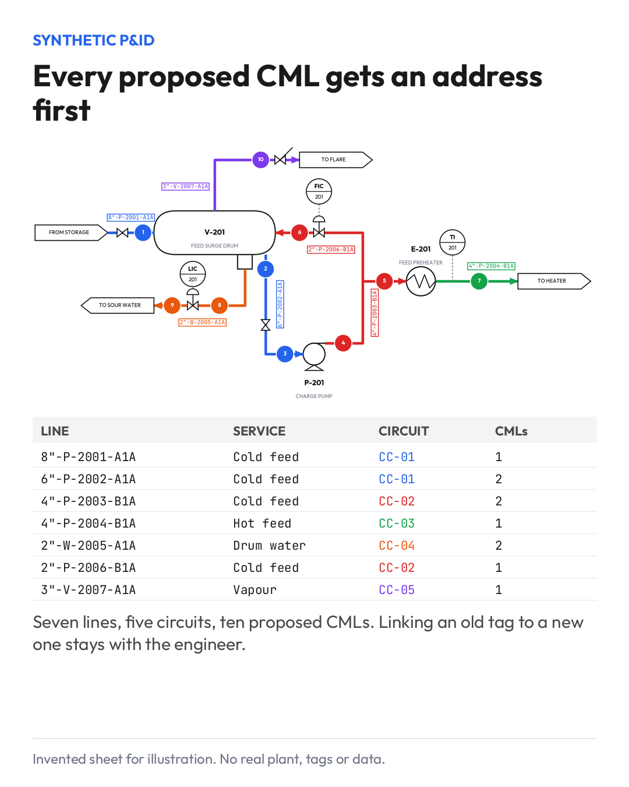

# One Elbow, Two Histories

Tuesday 2026-11-17

One elbow, two records in the thickness database. Each looks healthy. Together they say the next inspection is set four years too late.

A common case. A 4 inch pump discharge line is renumbered in a revamp. The old tag has readings from 2005 to 2019: 8.2 mm down to 6.4. The new tag starts in 2022 at 6.1 mm and reads 5.9 in 2025.

The new record knows nothing before 2022. Its rate is 0.2 mm in three years, 0.067 mm/yr. Against a required thickness of 4.5 mm that is 21 years of remaining life, so the interval goes to the 10 year maximum for its class.

Join the two histories and the long term rate is 8.2 minus 5.9 over 20 years: 0.115 mm/yr. Remaining life is 12 years and the half life interval is 6. Nothing corroded differently. The address changed.

API 570 5.6.3 is short about it: "Careful identification of CMLs and examination points are necessary to enhance the accuracy and repeatability of the data."

This is the part of the P&ID work I have been automating that gets the least attention. The image is an invented sheet: surge drum, charge pump, preheater. The drawing goes in and a register comes out: seven lines, five circuits and ten proposed CMLs, each with an identity tied to its line and circuit before anyone takes a reading. A reading for a tag that is not in the register is stopped at the door instead of quietly starting a new history.

What it cannot do is decide that an old tag and a new one are the same pipe. That link is an engineer's call, made once and recorded.

This week: list every CML whose first reading is later than its line's service date, and ask why.

How do you keep CML identity when a line is renumbered?

## Requirements quoted

> "Careful identification of CMLs and examination points are necessary to enhance the accuracy and repeatability of the data."
>
> API 570, 5.6.3

## Note

Invented sheet and illustrative numbers: no real plant, tags or data. Reference: API 570, 4th Edition (2016), 5.6.3 CML Allocation; the interval logic is in 6.3.3.
