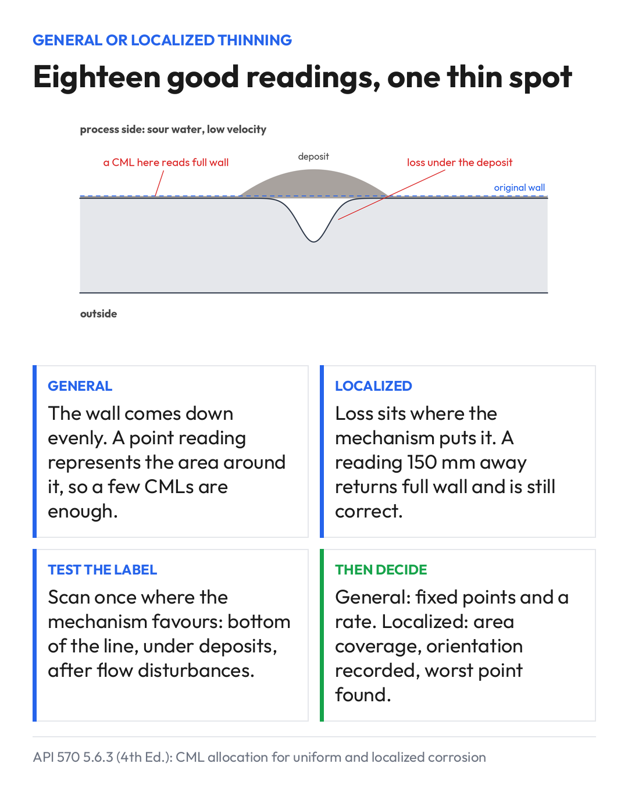

# Eighteen Good Readings and One Thin Spot

Wednesday 2026-11-18

Eighteen CMLs agree within 0.3 mm of each other. One scan, 150 mm away from the nearest of them, finds half the wall gone.

Take a 6 inch carbon steel sour water line at low velocity. Readings sit between 6.6 and 6.9 mm against 7.1 nominal, the rate is about 0.03 mm/yr, and the circuit is labelled general thinning. Every CML is on the side of the pipe, where a technician can reach.

Then a scan along the bottom of one horizontal run finds 3.4 mm under a line of settled deposit.

None of the eighteen readings was wrong. Each told the truth about its own spot. The error was the label. General thinning means a point represents its surroundings, so a few points describe a circuit. Localized loss breaks that. The metal goes where the mechanism puts it: under deposits, along the bottom, after a flow disturbance. A reading beside it returns full wall.

API 570 5.6.3 says it better than I can: "In theory, a circuit subject to perfectly uniform corrosion could be adequately monitored with a single CML. In reality, corrosion is seldom truly uniform and in fact may be quite localized, so additional CMLs may be required."

The stake is the remaining life. At 6.6 mm and 0.03 mm/yr this line had decades. At 3.4 mm, at a rate nobody has measured, it may have very little.

What I would do:

Write the expected form, general or localized, against every circuit, with the reason.

Where it could be localized, test the label once with a scan at the place the mechanism favours, and record the orientation.

Treat a tight cluster of readings as evidence about where you measured, not about the pipe.

Which of your circuits are labelled general because nobody scanned the bottom?

## Requirements quoted

> "In theory, a circuit subject to perfectly uniform corrosion could be adequately monitored with a single CML. In reality, corrosion is seldom truly uniform and in fact may be quite localized, so additional CMLs may be required."
>
> API 570, 5.6.3

## Note

Reference: API 570, 4th Edition (2016), 5.6.3 CML Allocation. The line and its readings are an illustrative case.
