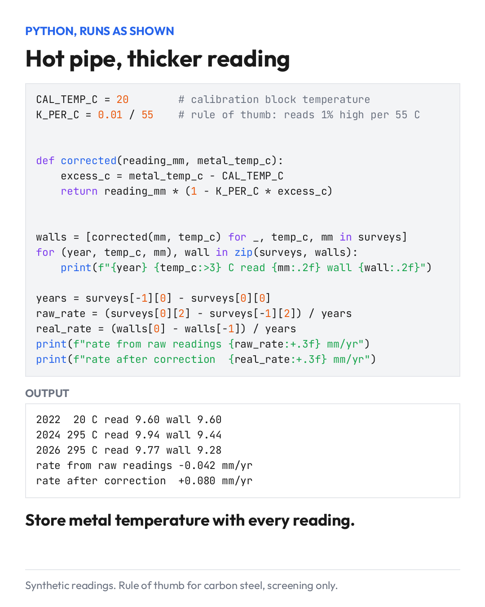

# The Wall Did Not Grow. The Pipe Was Hot.

Thursday 2026-11-19

A hot line read 9.60 mm in the 2022 turnaround and 9.94 mm on-stream in 2024. The wall did not grow. The pipe was at 295 C.

Sound travels slower in hot steel. A thickness gauge measures time and converts it with the velocity it was calibrated for, so a slower echo becomes a thicker wall. The field rule of thumb for carbon steel is about 1% too thick for every 55 C above calibration temperature.

The usual wrong move is to treat it as a glitch. The rate comes out negative, the software floors it at zero, and the CML reports no corrosion until the next cold survey, years later.

The code on the image works the case. Three synthetic surveys on one CML of a hot gas oil line: cold at 9.60 mm, then hot at 9.94 and 9.77 mm. First to last, as recorded, the rate is -0.042 mm/yr.

Corrected to calibration temperature, the hot readings are 9.44 and 9.28 mm. The rate is +0.080 mm/yr. On 3 mm of corrosion allowance that is the difference between "no corrosion" and less than 40 years of life.

API 570 5.7.1 covers it for readings above 65 C (150 F): "If the procedure does not compensate for higher temperatures, measurements should be adjusted by the appropriate temperature correction factor."

Two things to do. Store the metal temperature beside every reading, because without it nobody can repair the history later. And notice that the two hot readings agree with each other uncorrected: consistent conditions beat a correction factor.

The rule of thumb is a screening tool. A high temperature procedure, with a rated probe and couplant, is the real fix.

Does your database store the metal temperature of each reading?

## Requirements quoted

> "If the procedure does not compensate for higher temperatures, measurements should be adjusted by the appropriate temperature correction factor."
>
> API 570, 5.7.1

## Note

Runs as shown; readings are synthetic. Reference: API 570, 4th Edition (2016), 5.7.1. The code gives no factor: 1% per 55 C (100 F) is the common field rule of thumb for carbon steel, used here for screening only.
